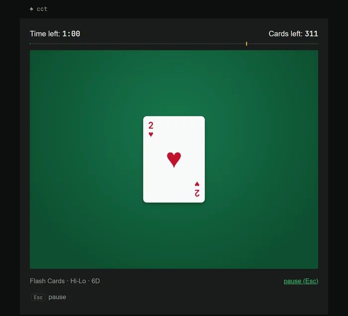
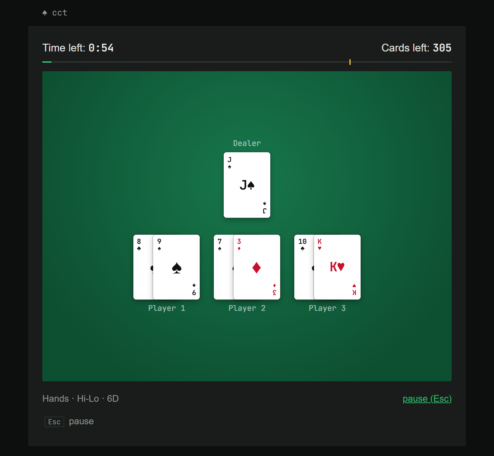
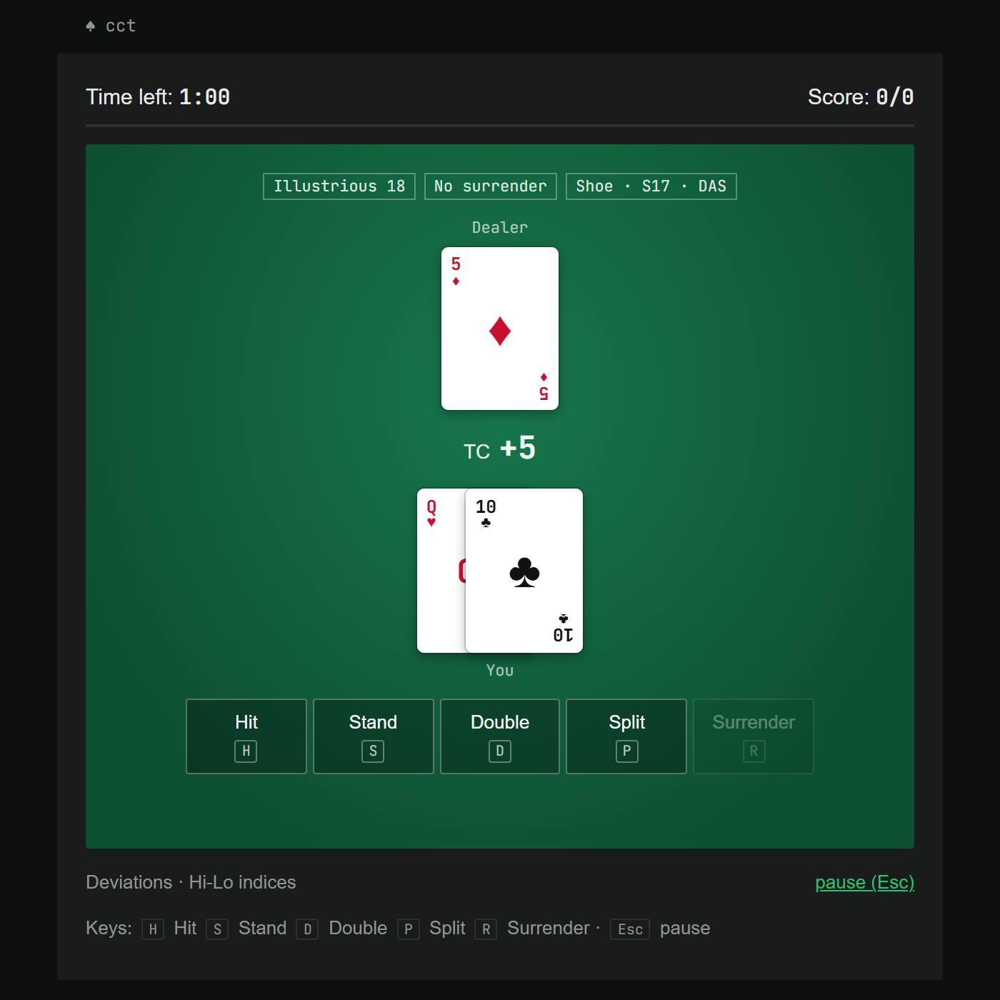
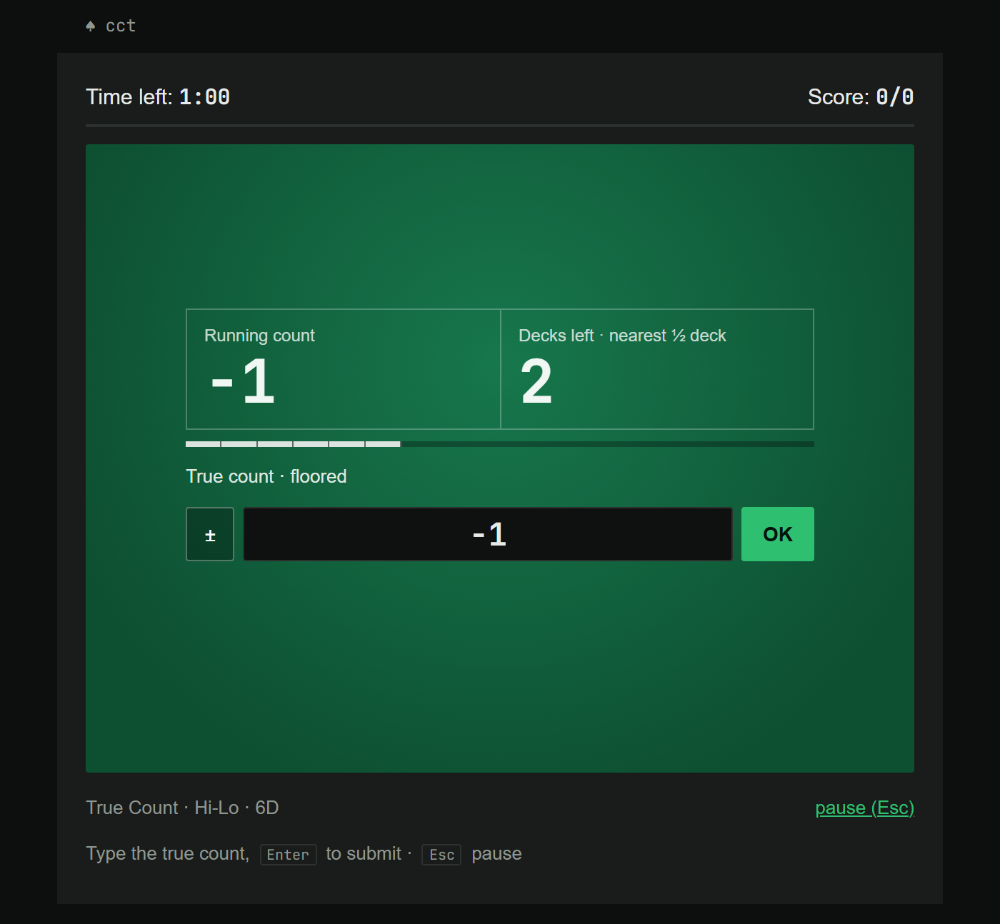
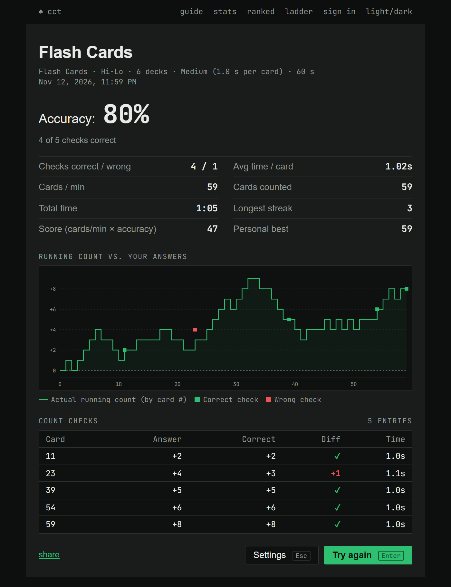
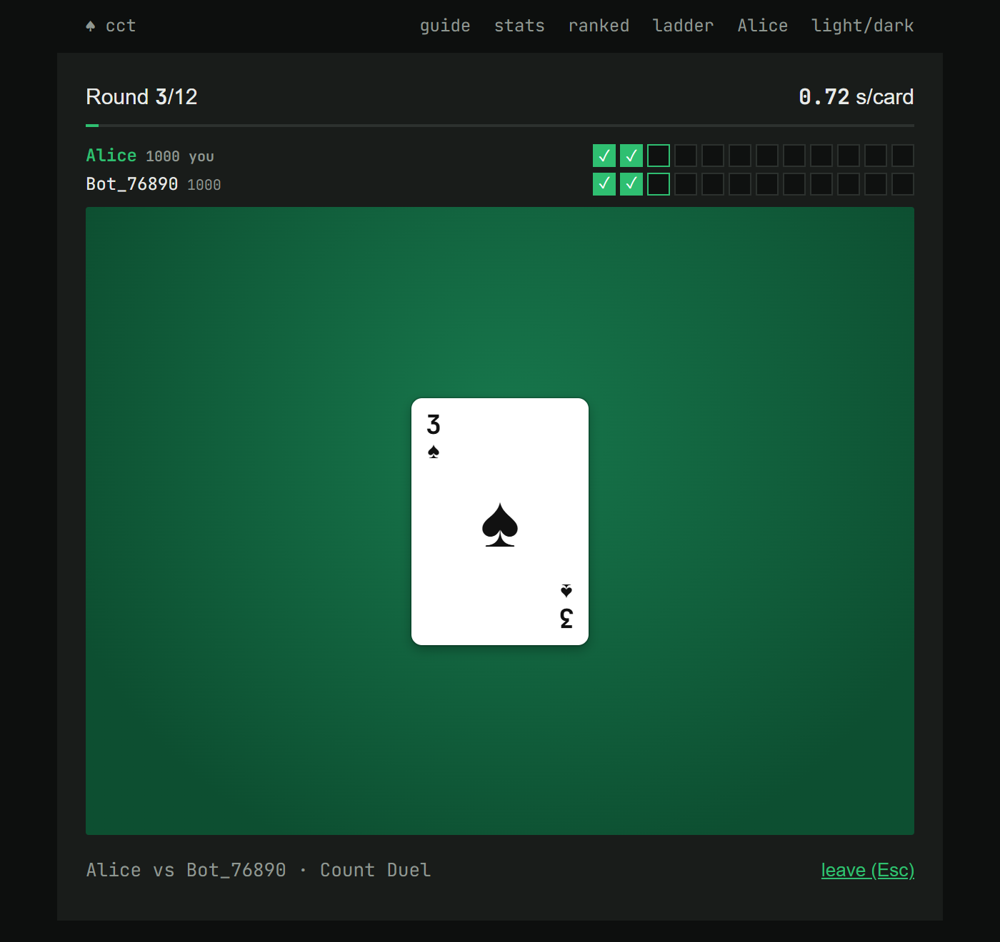
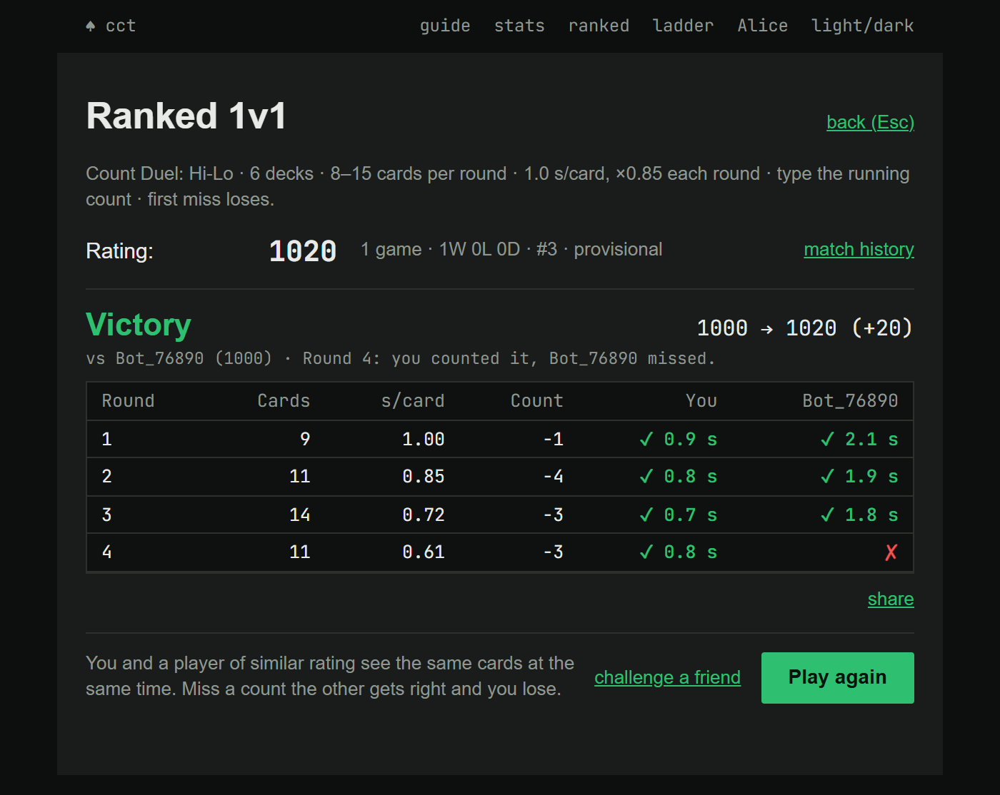
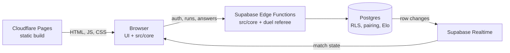
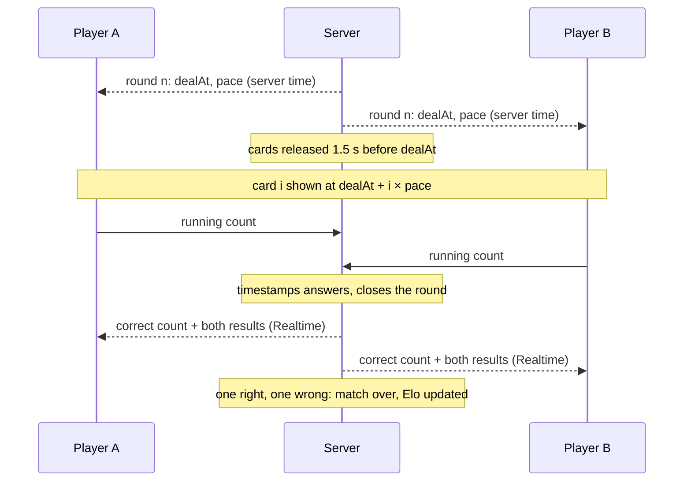

# Card Counting Trainer

A small web app I built to practice blackjack card counting, with timed drills and a 1v1 ranked mode.

**Live at [velua.xyz](https://velua.xyz)**

<p align="center"></p>

## What it does

- **5 drills**: Flash Cards (one card at a time), Hands (full rounds with a dealer), Speed Count (a whole shoe against the clock), True Count (convert running count to true count) and Deviations (Illustrious 18 + Fab 4 index plays).
- **5 counting systems**: Hi-Lo, KO, Omega II, Zen Count, Wong Halves. A system is just an entry in a config file.
- **Results and stats**: accuracy, speed, a chart of the real running count against your answers, local history and personal bests.
- **Count Duel**: a ranked 1v1 with matchmaking and Elo. Both players see the same cards at the same time; after each round you type the running count, and the first one to miss loses.
- **Friend challenges** through an invite link (unrated), and a match history with round-by-round details.
- Accounts with Google, GitHub or email. Without an account the trainer works fully offline.

| Hands | Deviations |
|---|---|
|  |  |
| **True Count** | **Results** |
|  |  |

| Count Duel: a round | Count Duel: result |
|---|---|
|  |  |

## How it works



A few parts I found interesting to build:

- **Same code on both sides.** Every random choice in a session (shoe order, when checks happen, questions) comes from a seeded RNG. The engine in `src/core/` has no DOM and no global state, so the Edge Functions run the exact same files. For a verified run the server picks the seed, replays the player's event log and computes the score itself; the client never sends a score.
- **The server is the referee in duels.** The seed stays in a table clients can't read, and the public match state has no cards until shortly before they're dealt. Each client measures its offset to the server clock and shows card *i* at `dealAt + i × pace`, so both players see each card at the same moment. Answers are timestamped by the server, and the finished duel is replayed from the seed before the result counts.



- **Matchmaking in SQL.** Pairing is a Postgres function using `FOR UPDATE SKIP LOCKED`, so two players polling at the same time can't grab the same opponent. Match updates use an optimistic version check, and the result, both ratings and the queue are written in one transaction. Row-level security keeps seeds, answers and ratings out of the clients' reach.
- **No framework.** Plain ES modules bundled with Vite; about 26 kB of gzipped JS on first load, with the Supabase client loaded lazily.
- **Guide pages generated from the app's data.** A small Vite plugin builds each page's meta tags and JSON-LD, the sitemap, and the tables in the guides (basic strategy, true count conversion, system comparison) from the trainer's own config.
- **Tests.** `bun test` covers the engine, the run verifier and the duel rules, including tampered logs. `scripts/duel-sim.js` plays full duels between two clients on a local Supabase and tries a list of cheats (reading the seed, answering early or twice, writing to protected tables) that all have to fail.

## Stack

Vanilla JavaScript, Vite, Bun · Supabase (Postgres, Auth, Realtime, Edge Functions) · Cloudflare Pages

## Run it locally

You need [Bun](https://bun.sh). The trainer alone:

```bash
bun install
bun run dev
```

Then open http://localhost:5173. With no Supabase config, the online features are just hidden.

For accounts and duels you also need Docker:

```bash
cp .env.example .env.development.local
bun run db:start
bun run functions
bun run dev
```

`db:start` prints a local URL and anon key to put in `.env.development.local`.

Tests:

```bash
bun test
bun scripts/duel-sim.js
```

`duel-sim` needs the local stack running (`db:start` and `functions`).

## Project structure

```
index.html            the trainer (all screens)
<guide>/index.html    static guide pages
site.config.js        page list for the SEO plugin
plugins/site.js       Vite plugin: meta tags, generated tables, sitemap
src/core/             pure engine shared with the server (rng, shoe, counts, verifier, duel rules, Elo)
src/session.js        training session state machine
src/ui/               screens (settings, stage, results, stats, account, duel)
src/backend.js        Supabase client, auth, runs and duel calls
supabase/migrations/  schema, RLS, pairing and commit functions
supabase/functions/   Edge Functions
tests/                bun tests
scripts/              duel simulation, test bot, image generation
```

## License

All rights reserved. The code is public so people can read it, but it is not open source: please don't copy, reuse or redistribute it without asking first.
